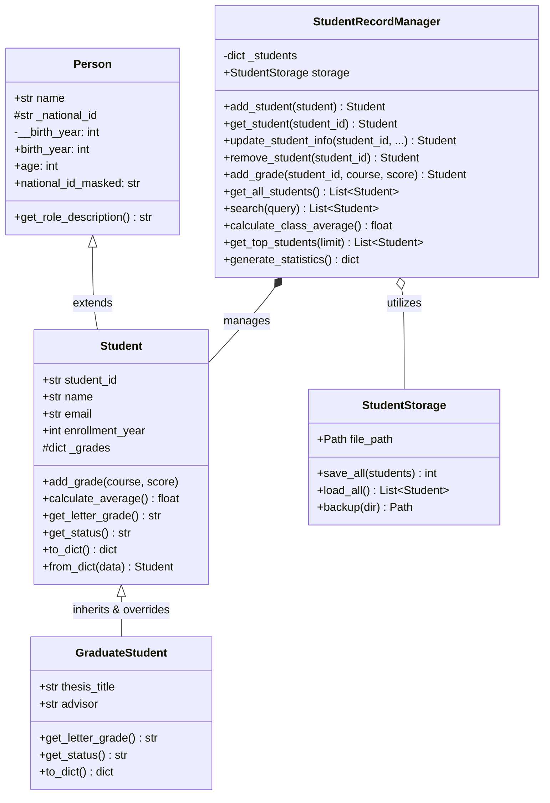

# Intermediate Python Practice – Week 2


> **Portfolio Project #2**: A practical, enterprise-grade Python showcase demonstrating Object-Oriented Programming (OOP), inheritance, encapsulation, modular package architecture, custom exception hierarchies, robust file I/O, JSON serialization, and virtual environment management.

---

## Table of Contents
- [1. Project Objectives](#1-project-objectives)
- [2. Repository Architecture](#2-repository-architecture)
- [3. System Design & Class Hierarchy](#3-system-design--class-hierarchy)
- [4. Concept Modules Breakdown](#4-concept-modules-breakdown)
- [5. Application Spotlight: Student Record Manager](#5-application-spotlight-student-record-manager)
- [6. Installation & Virtual Environment Setup](#6-installation--virtual-environment-setup)
- [7. How to Run](#7-how-to-run)
- [8. Testing & Verification](#8-testing--verification)
- [9. Key Takeaways & Best Practices](#9-key-takeaways--best-practices)

---

## 1. Project Objectives

This project systematically demonstrates intermediate Python mastery across seven key competencies:

1. **Classes and Objects (OOP)**: Class definition, object instantiation, constructor (`__init__`), instance attributes vs. class attributes, instance methods, `@classmethod` factory constructors, `@staticmethod` utilities, and dunder protocols (`__str__`, `__repr__`, `__eq__`).
2. **Inheritance and Encapsulation**: Single inheritance, `super()` method chaining, method overriding, runtime polymorphism, access conventions (public, protected `_`, private `__`), and managed properties (`@property`, `@setter`) with rigorous validation.
3. **Modules and Imports**: Standard library utilization (`math`, `datetime`, `statistics`, `pathlib`), custom module authoring, import aliases, clean public API declaration via `__all__`, and the `if __name__ == "__main__":` execution guard.
4. **Exception Handling**: Domain-specific custom exception hierarchies inheriting from `Exception`, `try`-`except`-`else`-`finally` execution flows, explicit `raise`, and exception chaining with `from`.
5. **File Handling**: Context managers (`with open(...)`), deterministic resource cleanup, file modes (`'r'`, `'w'`, `'a'`, `'r+'`), memory-efficient line streaming for large files, and filesystem safety using `pathlib.Path`.
6. **JSON Serialization & Deserialization**: In-memory transforms (`json.dumps`, `json.loads`), file-based streams (`json.dump`, `json.load`), custom `JSONEncoder` subclasses, `.to_dict()` / `.from_dict()` model serialization, and `json.JSONDecodeError` handling.
7. **Virtual Environments**: Complete lifecycle documentation for isolated Python development environments across Windows, macOS, and Linux.

---

## 2. Repository Architecture

```
intermediate-python-practice/
│
├── concepts/                               # Focused educational concept implementations
│   ├── 01_classes_and_objects.py           # OOP fundamentals, attributes, class/static methods
│   ├── 02_inheritance_and_encapsulation.py # Inheritance, super(), properties, access conventions
│   ├── 03_modules_and_imports.py           # Standard library, imports, aliases, __all__, __name__
│   ├── 04_exception_handling.py            # Custom exceptions, try/except/else/finally, chaining
│   ├── 05_file_handling.py                 # File modes ('w','a','r','r+'), context managers, streaming
│   └── 06_json_handling.py                 # dumps/loads, dump/load, custom encoders, JSON error handling
│
├── student_record_manager/                 # Production-grade OOP package
│   ├── __init__.py                         # Package exports and version metadata
│   ├── student.py                          # Student & GraduateStudent domain entities + exceptions
│   ├── storage.py                          # JSON persistence engine with context managers
│   ├── manager.py                          # Business logic service for CRUD & academic analytics
│   ├── main.py                             # Interactive CLI application & automated demo runner
│   └── data/
│       └── students.json                   # Seed JSON dataset with undergrad & grad records
│
├── examples/                               # Consumer integration examples
│   └── custom_module_demo.py               # External client consuming student_record_manager
│
├── test_week2.py                           # 32 comprehensive unit tests (unittest & pytest compatible)
├── requirements.txt                        # Project dependencies (pytest)
├── .gitignore                              # Comprehensive Python gitignore
├── VIRTUAL_ENVIRONMENT.md                 # Step-by-step virtual environment operations guide
└── README.md                               # Project documentation & portfolio guide
```

---

## 3. System Design & Class Hierarchy



---

## 4. Concept Modules Breakdown

Each module in [`concepts/`](file:///concepts) is fully executable, documented, and testable:

### 1. `01_classes_and_objects.py`
- **Class Attributes vs. Instance Attributes**: Demonstrates `university_name` and `total_courses_created` shared across instances, contrasting with individual `course_code` and `instructor` instance fields.
- **Methods**: Instance methods (`enroll_student`), factory class methods (`from_string`), and validation static methods (`is_valid_course_code`).
- **Dunder Methods**: `__str__` for human-readable output, `__repr__` for technical representations, and `__eq__` for value-based equality checking.

### 2. `02_inheritance_and_encapsulation.py`
- **Class Hierarchy**: `Person` (base) -> `Student` (derived) and `Faculty` (derived).
- **`super()`**: Reusing parent constructor logic while adding subclass-specific attributes.
- **Method Overriding & Polymorphism**: Subclasses provide customized implementations of `get_role_description()`, allowing homogeneous iteration across heterogeneous objects.
- **Encapsulation & Validation**: Attributes protected by convention (`_national_id`) and private attributes with name-mangling (`__birth_year`). Managed `@property` decorators validate inputs (e.g., rejecting negative or > 4.0 GPAs).

### 3. `03_modules_and_imports.py`
- **Standard Library**: Employs `math`, `statistics`, `datetime`, and `pathlib`.
- **Aliases & Namespaces**: `import statistics as stats` for clean calculations.
- **Execution Guard**: Explains why `if __name__ == "__main__":` protects imported modules from executing test scripts or side effects.
- **API Contracts**: Declares `__all__` to explicitly expose intended public symbols.

### 4. `04_exception_handling.py`
- **Domain Exception Tree**: Subclasses `StudentManagementError(Exception)` into `InvalidScoreError`, `StudentNotFoundError`, and `DuplicateStudentError`.
- **Flow Control**: Complete demonstration of `try` (risky operation), `except` (error handling), `else` (runs only when successful), and `finally` (guaranteed cleanup).
- **Exception Chaining**: `raise InvalidScoreError(...) from err` preserving the original stack trace.

### 5. `05_file_handling.py`
- **Context Managers**: Guaranteed closing of file descriptors with `with open(...) as f:`.
- **Modes**: Comparison of `'w'` (overwrite), `'a'` (append), `'r'` (read), and `'r+'` (in-place update).
- **Streaming**: Demonstrates generator-based line-by-line streaming for memory efficiency.
- **Platform Resilience**: Utilizes `tempfile` and `pathlib.Path` to prevent cloud-sync file locks (such as OneDrive).

### 6. `06_json_handling.py`
- **Transforms**: In-memory `json.dumps()` / `json.loads()` and streaming `json.dump()` / `json.load()`.
- **Custom Objects**: Serializing arbitrary Python domain models using `json.JSONEncoder` and `.to_dict()` / `.from_dict()` patterns.
- **Error Handling**: Graceful trapping of `json.JSONDecodeError` reporting line and column positions.

---

## 5. Application Spotlight: Student Record Manager

The [`student_record_manager`](file:///student_record_manager) package demonstrates these concepts synthesized into a cohesive, decoupled software application:

- **Entity Modeling**: Undergraduate and graduate student classes with property validation.
- **Polymorphic Grading**: Graduate students adhere to stricter grading criteria (no D grades awarded, 75% minimum required for good standing).
- **Data Persistence**: `StudentStorage` serializes and deserializes the student database to [`students.json`](file:///student_record_manager/data/students.json), handling missing or corrupted files with defensive fallback mechanisms.
- **Analytics & Search**: Calculates class mean, GPA distributions, pass rates, and executes case-insensitive searches across IDs, names, emails, and graduate research topics.
- **Interactive CLI & Demo Mode**: Fully usable console menu supporting both interactive user flows and an automated `--demo` walkthrough.

---

## 6. Installation & Virtual Environment Setup

For comprehensive instructions, see [`VIRTUAL_ENVIRONMENT.md`](file:///VIRTUAL_ENVIRONMENT.md).

### Quickstart (Windows PowerShell)

```powershell
# 1. Clone or navigate to the workspace
cd c:\Users\anant\OneDrive\Desktop\Python_Intermediate_Week02

# 2. Create an isolated virtual environment
python -m venv .venv

# 3. Activate the virtual environment
.\.venv\Scripts\Activate.ps1

# 4. Install development dependencies
pip install -r requirements.txt
```

*(On macOS/Linux, activate via `source .venv/bin/activate`)*

---

## 7. How to Run

### Run Any Concept Demonstration Script
```powershell
python concepts/01_classes_and_objects.py
python concepts/02_inheritance_and_encapsulation.py
python concepts/03_modules_and_imports.py
python concepts/04_exception_handling.py
python concepts/05_file_handling.py
python concepts/06_json_handling.py
```

### Run the Student Record Manager CLI
```powershell
# Interactive menu mode:
python -m student_record_manager.main

# Automated headless demo mode:
python -m student_record_manager.main --demo
```

### Run the Custom Module Consumer Demo
```powershell
python examples/custom_module_demo.py
```

---

## 8. Testing & Verification

The project includes 32 automated unit tests across all concepts and service components.

### Run with Python Standard `unittest`
```powershell
python test_week2.py
```

### Run with `pytest`
```powershell
pytest test_week2.py -v
```

### Test Suite Output
```
test_week2.py::TestClassesAndObjects::test_class_attribute_and_count PASSED            [  3%]
test_week2.py::TestClassesAndObjects::test_class_method_alternative_constructor PASSED [  6%]
test_week2.py::TestClassesAndObjects::test_dunder_methods PASSED                       [  9%]
test_week2.py::TestClassesAndObjects::test_enroll_and_drop_students PASSED            [ 12%]
test_week2.py::TestClassesAndObjects::test_instance_attributes PASSED                 [ 15%]
test_week2.py::TestClassesAndObjects::test_static_method_validation PASSED            [ 18%]
test_week2.py::TestInheritanceAndEncapsulation::test_person_encapsulation_and_properties PASSED [ 21%]
test_week2.py::TestInheritanceAndEncapsulation::test_polymorphism_and_isinstance PASSED [ 25%]
test_week2.py::TestInheritanceAndEncapsulation::test_property_validation PASSED       [ 28%]
test_week2.py::TestInheritanceAndEncapsulation::test_student_inheritance_and_super PASSED [ 31%]
test_week2.py::TestModulesAndImports::test_compute_statistics PASSED                   [ 34%]
test_week2.py::TestModulesAndImports::test_empty_statistics_raises PASSED              [ 37%]
test_week2.py::TestModulesAndImports::test_inspect_module_environment PASSED          [ 40%]
test_week2.py::TestModulesAndImports::test_letter_grade_conversion PASSED             [ 43%]
test_week2.py::TestExceptionHandling::test_calculate_average_safe PASSED              [ 46%]
test_week2.py::TestExceptionHandling::test_custom_exception_hierarchy PASSED         [ 50%]
test_week2.py::TestExceptionHandling::test_validate_and_parse_score_failures PASSED   [ 53%]
test_week2.py::TestExceptionHandling::test_validate_and_parse_score_success PASSED    [ 56%]
test_week2.py::TestFileHandling::test_file_lifecycle_in_tempdir PASSED                 [ 59%]
test_week2.py::TestFileHandling::test_missing_file_raises_filenotfound PASSED          [ 62%]
test_week2.py::TestJsonHandling::test_custom_object_serialization PASSED              [ 65%]
test_week2.py::TestJsonHandling::test_dump_and_load_file PASSED                        [ 68%]
test_week2.py::TestJsonHandling::test_dumps_and_loads PASSED                           [ 71%]
test_week2.py::TestJsonHandling::test_malformed_json_raises_value_error PASSED        [ 75%]
test_week2.py::TestStudentRecordManager::test_corrupt_storage_file_handling PASSED     [ 78%]
test_week2.py::TestStudentRecordManager::test_graduate_student_inheritance_and_polymorphism PASSED [ 81%]
test_week2.py::TestStudentRecordManager::test_manager_analytics_and_statistics PASSED [ 84%]
test_week2.py::TestStudentRecordManager::test_manager_crud_operations PASSED          [ 87%]
test_week2.py::TestStudentRecordManager::test_serialization_and_deserialization PASSED [ 90%]
test_week2.py::TestStudentRecordManager::test_storage_persistence PASSED               [ 93%]
test_week2.py::TestStudentRecordManager::test_student_grades_and_status PASSED         [ 96%]
test_week2.py::TestStudentRecordManager::test_student_validation PASSED                [100%]

============================= 32 passed in 0.17s ==============================
```

---

## 9. Key Takeaways & Best Practices

1. **Favor Composition & Managed Encapsulation**: Use `@property` getters and setters with explicit validation to enforce class invariants while keeping clean attribute-access syntax (`student.gpa = 3.8`).
2. **Deterministic Resource Management**: Always handle files using context managers (`with open(...)`) to prevent file descriptor leakage across concurrent operating systems.
3. **Explicit Exception Contracts**: Define domain-specific exceptions inheriting from a common base (`StudentRecordError`) rather than catching generic `Exception`.
4. **Decoupled Architecture**: Keep storage I/O (`StudentStorage`), business logic (`StudentRecordManager`), and domain representation (`Student`) separated into single-responsibility layers.
5. **Always Sandbox**: Use virtual environments (`.venv/`) and lock down dependencies with `requirements.txt` to guarantee clean, reproducible execution environments.

---

*Authored as part of the Intermediate Python Portfolio Series.*

